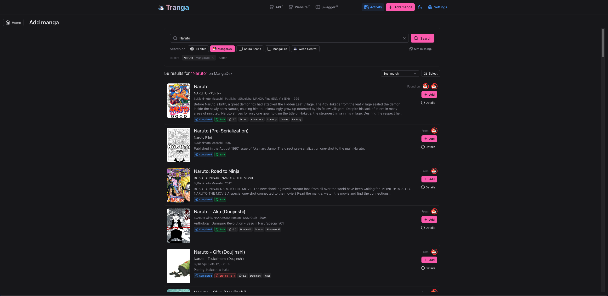

 

<h3 align="center">Tranga-Website</h3>

  

    Automatic Manga and Metadata downloader 
  

  

    This is the Website for <a href="https://github.com/C9Glax/tranga">Tranga</a> (API)  
  

  

  <table>
    
  </table>

<!-- ABOUT THE PROJECT -->
## Screenshots

|  |  |  |
|----------------------------------------|------------------------------------------|------------------------------------------------|
| Old Overview                               | Old Search Dialog                            | Old Manga Detail                                   |

|  |  |  |
|----------------------------------------|------------------------------------------|------------------------------------------------|
| Overview                               | Search Dialog                            | Manga Detail                                   |

## About The Project

Tranga-Website is the Web-frontend to [Tranga](https://github.com/C9Glax/tranga) (the API).

### What this does do (and nothing else)

This project makes HTTP-requests to the [Tranga-API](https://github.com/C9Glax/tranga) to display and modify the present configuration.

## What's different in this fork

Changes compared with [C9Glax/tranga-website](https://github.com/C9Glax/tranga-website) (`cuttingedge`).
Needs the matching API fork for the features marked *(API)*.

### Home (manga list)
- New overview list: cover, title, alternative title, synopsis and release status for every manga
- Same details on every row, in a fixed order: Chapters, Latest chapter, Last downloaded, Newer on MangaUpdates, Volumes, Published (start – end), Rating; **N/A** when unknown
- Writer, illustrator, publisher, magazine and content rating (from MangaUpdates and MangaDex)
- Sort A–Z with an alphabetical jump bar
- Filters: status, age rating, genres, writer, artist, publisher
- Select several manga and delete them in one go
- Refresh one manga or a selection *(API)*
- Clearer status wording and better use of wide screens

### Manga page
- Redesigned layout with clearer labels
- Delete individual downloaded chapters, with file sizes *(API)*
- Extra details stored by the API, so the page loads faster *(API)*
- Preview the reader metadata (ComicInfo.xml) for the series *(API)*

### Add manga (search)
- Detailed results: cover, credits, year, synopsis, status, age rating, MangaUpdates rating and genres, and which website(s) it was found on
- Add one result or several at once
- Marks manga already in your library and warns about likely duplicates from another site
- Sorting, clear error messages and remembered recent searches
- Paste a link from any supported website, including ones added from FMD2
- "Site missing?" link to add more websites

### Activity
- Readable history of what Tranga has done
- Running and scheduled jobs in plain English
- Live log viewer *(API)*

### Settings
Redesigned into sections, with changes saved straight away:
- **Libraries**: download folders and Komga / Kavita servers, with connection tests
- **Kavita covers**: send Tranga's cover to Kavita automatically or on request, optionally lock it *(API)*
- **Naming**: series folder and chapter file naming, plus a tool to rename existing folders *(API)*
- **Reader metadata**: ComicInfo.xml for Kavita/Komga, update all downloaded chapters *(API)*
- **Downloads**: language, image compression, black & white
- **Performance**: presets for Raspberry Pi / NAS, low-end and high-end desktops, or custom; simultaneous downloads in total and per website *(API)*
- **Network**: FlareSolverr and user agent
- **Notifications**: add, test and delete notification services
- **More websites (FMD2)**: link to the FMD2 page
- **Maintenance**: tidy the database and clear the activity log
- **Stats**: overview of your library and disk use

### More websites (FMD2) — new page
- Add websites by uploading Lua modules from [FMD2](https://github.com/dazedcat19/FMD2), with step-by-step instructions on the page
- Switch each website on or off, test it on a manga link, build its title list for searching, delete files
- Tested with MangaFire, Asura Scans and WeebCentral *(API)*

### Fixes
- MangaUpdates proxy error (426 Upgrade Required)
- Website failing to start because of the MangaDex proxy rule

## Built With

- nginx
- [nuxt](https://github.com/nuxt/nuxt)
- [nuxt ui](https://github.com/nuxt/ui)
- [vue](https://github.com/vuejs/)
- [vite](https://github.com/vitejs/vite)
- 💙 Blåhaj 🦈

(<a href="#readme-top">back to top</a>)

<!-- GETTING STARTED -->
## Getting Started

Go to [Tranga](https://github.com/C9Glax/tranga?tab=readme-ov-file#getting-started) and read the README there.

<!-- CONTRIBUTING -->
## Contributing

Go to [Tranga](https://github.com/C9Glax/tranga?tab=readme-ov-file#contributing) and read the README there.

<!-- LICENSE -->
## License

See `LICENSE.txt` for more information.

(<a href="#readme-top">back to top</a>)

<!-- ACKNOWLEDGMENTS -->
## Acknowledgments

* [Choose an Open Source License](https://choosealicense.com)
* [Font Awesome](https://fontawesome.com)
* [Best-README-Template](https://github.com/othneildrew/Best-README-Template/tree/master)

(<a href="#readme-top">back to top</a>)

